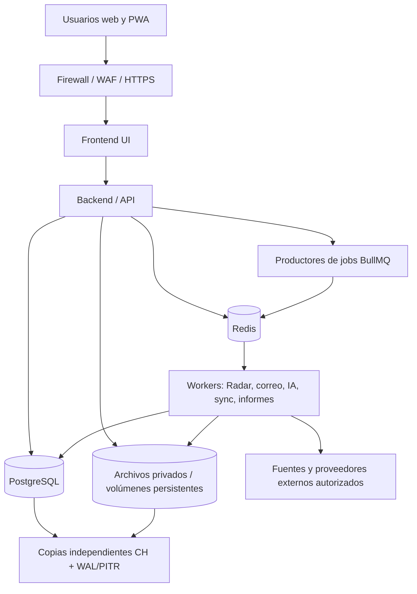

# CleanOps 360 — Arquitectura técnica derivada

**Fecha de revisión:** 2026-10-09  
**Estado:** DRAFT TÉCNICO / NO IMPLEMENTADO  
**Fuentes normativas:** `CLEANOPS_360_PRODUCT_MASTER_V3.md`, `CLEANOPS_360_SRS_V1_1.md` consolidados 2026-10-09 y 26 decisiones aprobadas.  
**Regla:** en caso de conflicto, prevalece el SRS normativo y una decisión posterior expresamente aprobada. Lo marcado **[PROPUESTA]** requiere validación técnica; lo marcado **[GATE]** requiere evidencias antes de liberar la función.

## 1. Alcance y límites

CleanOps 360 es un producto independiente, multi-tenant y autocontenido para empresas de limpieza y facility services. Su ciclo comercial-operativo es `hallazgo → oportunidad → contacto → visita → oferta → adjudicación → WorkEngagement → planificación → ejecución → horas/rapports → factura → cobro → cierre/renovación`. No se desarrollan ni ejecutan servicios, migraciones, redes o aplicaciones con este documento.

Los cuatro tipos de `WorkEngagement` son `PROJECT`, `RECURRING_SERVICE`, `ONE_OFF_SERVICE` y `MAINTENANCE_CONTRACT`. Todos utilizan el **Planning Engine único**. El calendario es una vista de planificación, no un segundo motor.

## 2. Topología aprobada

**[APROBADO]** Un solo VPS situado en Suiza aloja la aplicación y los datos; Docker gestiona frontend, backend/API, PostgreSQL, Redis/BullMQ, workers y almacenamiento privado persistente. La protección DDoS la proporciona un proveedor suizo verificable; el firewall/WAF es propio. Backups independientes y almacenamiento de recuperación permanecen en Suiza. Un único VPS es un punto único de fallo; la disponibilidad no queda garantizada por diseño.

El diagrama es lógico: no supone que todas las conexiones sean directas ni que haya servicios públicamente expuestos.

### 2.1 Contenedores y responsabilidades

| Componente | Responsabilidad | Invariante | Estado |
|---|---|---|---|
| Frontend/PWA | UI administrativa y operativa, My Day, modo offline | Ninguna autorización depende solo de UI | Aprobado funcionalmente |
| API modular | Casos de uso, autenticación, RBAC, tenant, validaciones, auditoría | Único punto de aplicación de políticas de dominio | [PROPUESTA] organización interna |
| PostgreSQL | Transacciones, estados, relaciones, historial, auditoría | Separación por tenant, constraints e integridad | Aprobado |
| Redis + BullMQ | Trabajos, programación, reintentos y concurrencia | No usar Redis como registro de negocio definitivo | Aprobado |
| Workers | Radar, enriquecimiento, correo, IA, documentos, normativa y notificaciones | Idempotencia, límites, logs, políticas y permisos | Aprobado funcionalmente |
| Archivos VPS | Contratos, planos, imágenes, rapports, adjuntos | Fuera de webroot, control de acceso, respaldos independientes | Aprobado |
| Backup/restore | Base PITR + archivos/configuración/secrets reconstituibles | Objetivos RPO 15 min/RTO 4 h **a demostrar** | [GATE] |

### 2.2 Segmentación y superficies expuestas

**[PROPUESTA]** Publicar solo el punto de entrada HTTPS. PostgreSQL, Redis, volúmenes y endpoints de workers no tendrán exposición pública. Aplicar redes Docker separadas para ingreso, API y datos; permisos mínimos por servicio; credenciales y secretos fuera del repositorio; TLS para accesos administrativos/remotos. El proveedor VPS, requisitos de red y WAF se verificarán antes de producción.

## 3. Dominios y límites de responsabilidad

| Dominio lógico | Responsabilidad propietaria | Entidades principales |
|---|---|---|
| Identity & Access | cuentas, MFA, sesiones, roles, políticas y overrides | Organization, User, Session, Role, Permission |
| CRM & Compliance | empresas, contactos, consentimientos/base de comunicación y supresión | Company, Contact, ContactCompliance, Suppression |
| Radar | conectores, hallazgos, candidatos, dedup, procedencia | SourceConnector, RawFinding, ProjectCandidate |
| Sales | oportunidades, pipeline, citas, ofertas, negociaciones | Opportunity, SiteVisit, Offer, OfferVersion |
| Communications | bandeja, hilos, correo, follow-up y clasificación | EmailAccount, EmailThread, Email, FollowUp |
| Engagement | conversión comercial-operativa, contratos y servicios | WorkEngagement, Contract, Project, RecurringService |
| Planning | restricciones, propuesta, publicación, calendario y reconocimiento | Assignment, Shift, ScheduleVersion, ClientInstruction |
| Field Operations | fases, unidades, planos, horas, rapports e incidentes | WorkLog, Timesheet, Rapport, PlanVersion |
| Finance | conceptos facturables, facturas, pagos y estados | Invoice, InvoiceLine, Payment |
| Governance | IA, reglas, auditoría, notificaciones, cuotas, seguridad | ComplianceRuleSet, AiRun, AuditLog, SecurityEvent |

**[PROPUESTA]** Los límites anteriores son módulos lógicos en un producto modular, no microservicios ni VPS adicionales. Sus APIs, transacciones y eventos se concretarán al crear las especificaciones técnicas.

## 4. Flujos normativos sin ambigüedad

### 4.1 Descubrimiento y promoción

`SourceConnector → RawFinding → Normalize → Deduplicate → Enrich → ProjectCandidate`. El candidato NO es una oportunidad comercial. Usuarios autorizados pueden ejecutar **Promote to Opportunity** tras validación de permisos y deduplicación. La acción genera vínculo, historial, auditoría y navegación al nuevo registro (`REQ-RAD-003/004/005`). Las oportunidades manuales no exigen candidato.

### 4.2 Oferta aceptada y alta operativa

`Offer.Accept → Opportunity.Won` es inmediato y obligatorio (`REQ-WE-001`). Se establece `work_engagement_creation_status=PENDING` y aparece `Crear WorkEngagement`. **No** se crea automáticamente. Solo la acción humana autorizada lo crea, marca `CREATED`, vincula origen y registra auditoría (`REQ-WE-002`). WorkEngagement creado **no** equivale a contrato firmado (`REQ-WE-003`). **[PROPUESTA]** Proteger ambos comandos con transacciones e idempotencia para impedir dobles conversiones.

### 4.3 Contacto y correo

SMTP+IMAP configurables por tenant. Modos `AUTO`, `APPROVAL`, `MANUAL` no anulan suppression, `DO_NOT_CONTACT`, base de comunicación ni aprobación del primer contacto frío sin política validada. La IA redacta y clasifica, pero no aprueba precios/contratos. Procesar emails externos como contenido no confiable. Reintentos no deben enviar duplicados; registrar ID del proveedor y resultado cuando estén disponibles.

### 4.4 Planificación e instrucciones de cliente

Un único Planning Engine genera propuestas y alertas para todo WorkEngagement. Publicación humana. Las ClientInstruction tienen efecto trazable según tipo; nunca se quedan solo como comentarios (`REQ-CLI-002`). Cambios de planificación publicada crean nueva versión y reconocimiento según `REQ-CAL-004`, no alteraciones silenciosas.

### 4.5 Rapports y facturación

`worked_hours`, `validated_hours`, `invoiced_hours` y `paid_hours` se mantienen separados. La validación exigida depende del contrato; horas discutidas se registran aparte. Regie: horas facturables; Pauschal: hitos/fechas; recurrentes: periodicidad. Borrador, emisión y envío son acciones diferentes con autorización, trazabilidad y no duplicación. Provisional solo si está permitido contractualmente.

### 4.6 Renovaciones

Alertas y opciones `Renew`, `Renegotiate`, `Terminate`, `Postpone decision`. Renovación automática únicamente con cláusula expresa verificada; cambios de importes y renegociaciones requieren aprobación humana. El cálculo de preaviso debe respetar contrato y zona aplicable; no presuponer renovación tácita universal.

## 5. Autenticación y autorización

**[APROBADO]** Gestión propia con bibliotecas maduras, sin criptografía casera. MFA por riesgo: obligatorio para roles sensibles; empleados operativos según tenant; step-up para operaciones sensibles. OTP de email de 5 minutos, un uso, hash, invalidación en reenvío, rate limiting. Trusted device 30 días no alarga la sesión. Inactividad: 30 min para administración/comercial/finanzas y 8 h para empleados operativos; caducidad absoluta separada **[GATE: valor por determinar]**.

**[APROBADO]** Explicit deny prevalece; default deny, límites entre tenants y permisos de recursos/tiempo; verificar en cada API/worker relevante. **[PROPUESTA]** Construir evaluación de permisos como función central y documentar política efectiva para cada comando, incluidos eventos asíncronos.

## 6. Sincronización offline

**[APROBADO]** IndexedDB y cola local, sync incremental, versiones y resolución humana de conflictos significativos. **[PROPUESTA]** Cada mutación offline llevará identificador idempotente, versión conocida del recurso, timestamp local solo informativo y usuario/dispositivo. El backend decide si se acepta, se rechaza o se envía a resolución manual; no utilizar `last write wins` en datos críticos.

| Clase | Regla propuesta para validar | Riesgo que cubre |
|---|---|---|
| Foto/adjunto nuevo | Subida reanudable o reintento idempotente; vincular tras validación | Duplicados, archivo huérfano |
| WorkLog nuevo | Append o creación idempotente; correcciones posteriores versionadas | Doble cómputo |
| Timesheet editado | Optimistic locking y conflicto visible | Sobrescritura de horas |
| Instrucción de cliente | Registro inmutable de origen + acción operacional explícita | Pérdida de instrucciones |
| Asignación publicada | Nunca reconciliación silenciosa; revisión del Planner | Turnos inconsistentes |
| Permisos/contratos/facturas | No asumir edición offline autorizada; revalidar siempre | Escalada de privilegios |

**[GATE]** Aprobar matriz detallada por entidad; probar revocaciones durante periodo offline, doble sincronización y datos conflictivos conservados localmente hasta resolución. Si una sesión caduca, reautenticar antes de enviar cambios.

## 7. Seguridad de ficheros y política IA

Archivos en volúmenes privados del VPS con rutas no públicas, permisos por tenant/recurso, URL temporal mediada o descarga autorizada, cuarentena, detección MIME/magic bytes, antimalware y controles de bombas de archivo. Valores iniciales: fotografías 20 MB, documentos 50 MB, planos/técnicos 100 MB; máximos globales y cuotas requieren definición **[GATE]**.

**[APROBADO]** IA multiproveedor por tarea, coste, calidad y privacidad; no transmitir datos protegidos fuera de Suiza sin autorización y garantías verificadas. **[PROPUESTA]** Implementar registro de proveedores con ubicación real, fines, modelos, clasificación de datos permitida y política por tenant; denegar por defecto transferencias desconocidas. Los correos y documentos extraídos son entradas no confiables.

## 8. Recuperación, backups y continuidad

**[APROBADO]** Backups completos diarios; archivado continuo WAL de PostgreSQL para PITR y copias independientes en Suiza. RPO **objetivo** 15 minutos; RTO **objetivo** 4 horas, sujetos a prueba. 

**[PROPUESTA]** Mantener inventario de ficheros/manifest con versión/hash y referencias a objetos lógicos; asociar cada corte de backup de archivos a un checkpoint de base. Durante restore escoger punto consistente, verificar integridad, reportar archivos huérfanos y referencias rotas; practicar recuperación completa de VPS usando servidor sustituto suizo. Las claves/secretos requieren mecanismo de recuperación separado y seguro.

**[GATE]** Simular pérdida total del VPS, recuperar aplicación+DB+archivos, medir RPO/RTO, comprobar tenants, permisos y evidencia auditada. Si no pasa, revisar infraestructura; no presentar objetivos como SLA.

## 9. Observabilidad, releases y calidad

Logs estructurados con correlation id para comandos, jobs y auditoría; métricas de colas, sincronización, correo, errores de Radar, almacenamiento y restauración. Evitar secretos y datos sensibles en logs. Fases `LOCAL → STAGING → PRODUCTION`; branch → tests → staging → Codex validation → prueba manual Product Owner → `ACCEPTED` → release. Ninguna fase dependiente avanza sin aceptación salvo autorización explícita. La entrega de cada vertical slice exige UI, API, DB, RBAC, estados de error/carga/vacío, auditoría, tests unit/integration/E2E/security, build y verificación humana.

## 10. Registro de puertas de validación (sin reabrir decisiones)

| ID | Gate pendiente | Condición de cierre |
|---|---|---|
| ARC-G01 | Proveedor VPS suizo / DDoS / WAF | Contratos, residencia y protección verificados |
| ARC-G02 | Sesión absoluta | Valor aprobado y tests |
| ARC-G03 | Máximos de archivo y cuotas | Límites de servidor/tenant probados |
| ARC-G04 | PITR + archivos | Runbook, manifiesto y restore consistente probado |
| ARC-G05 | RPO/RTO | Simulacro y métricas ≤ objetivos |
| ARC-G06 | Offline por entidad | Matriz de conflictos, retry e idempotencia verificada |
| ARC-G07 | IA proveedores | Registro y pruebas de bloqueo por residencia/política |
| ARC-G08 | Normativa y envío | GAV/CCT vigente, retención, límites SMTP y condiciones Radar validadas |

## 11. Trazabilidad mínima

`REQ-PR-001/002/003/006/007`, `REQ-TEN-*`, `REQ-AUTH-*`, `REQ-AUTHZ-*`, `REQ-RAD-003/004/005`, `REQ-WE-001/002/003`, `REQ-CLI-002`, `REQ-CAL-004`, `REQ-SCH-003`, `REQ-RPT-002`, `REQ-OFFLINE-001` y los requisitos adicionales del §44.1 del SRS. Antes de implementar se generarán `FEATURE_TRACEABILITY_MATRIX.md`, `ENTITY_UI_COVERAGE.md` y `THREAT_MODEL.md`.

**Fin. Estado documental: diseño técnico derivado, sin implementación.**
