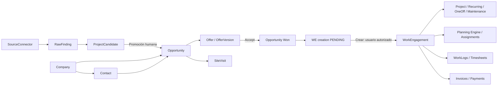

# CleanOps 360 — Modelo de datos lógico derivado

**Fecha:** 2026-10-09  
**Estado:** DRAFT LÓGICO / NO DDL NI MIGRACIONES  
**Fuentes:** Product Master V3 §117; SRS V1.1 §§3–36, 44.1–45; decisiones 1–26 aprobadas.  
**Convención:** **[BASE]** aparece en la fuente; **[DERIVADO]** relación o entidad necesaria para materializar un requisito; **[PROPUESTA]** diseño no decidido ni definitivo. No se asignan tipos SQL, nombres definitivos de columnas o índices no aprobados.

## 1. Reglas transversales

1. Todos los registros de negocio con ámbito de empresa deben vincularse al tenant/organization. La base de datos y cada API hacen cumplir el aislamiento, también en jobs y búsquedas; prohibido cross-tenant.
2. No confundir ID de origen externo, identidad de contacto, candidato, oportunidad, oferta, contrato o WorkEngagement.
3. Mantener procedencia, confianza y fecha de verificación de datos críticos. Una fuente automática nunca sobreescribe silenciosamente un dato manual verificado.
4. Estados y transiciones sensibles se registran en historial/auditoría; una fila editable no sustituye la evidencia del evento.
5. Versionar ofertas, planificación publicada, planos y reglas laborales; nunca sobrescribir revisiones anteriores.
6. `worked_hours`, `validated_hours`, `invoiced_hours`, `paid_hours` no son una sola cifra mutable.
7. Los datos personales, documentos, retención y procesamiento IA están sujetos a política de tenant y categoría.
8. Los campos de infraestructura (IDs de jobs, hashes de integridad, timestamps) son detalles por especificar; no se consideran DDL autorizado.

## 2. Catálogo de entidades y propiedad

| Dominio owner | Entidades fuente (nombres lógicos) | Gestión principal |
|---|---|---|
| Identidad | organizations, users, auth_identities, sessions, mfa_methods, mfa_challenges, recovery_codes | Tenant/Admin; sistema para sesiones/challenges |
| Autorización | roles, permissions, user_permission_overrides, temporary_permissions | Admin; decisiones de acceso auditadas |
| CRM/compliance | companies, contacts, contact_compliance, suppression_list | Usuario autorizado + automatización controlada |
| Radar | source_connectors, raw_findings, project_candidates, project_sources | Conector/sistema; revisión y promoción humana |
| Oportunidades | opportunities, opportunity_sources, tasks, appointments, site_visits | Comercial y usuarios autorizados |
| Comunicación | email_accounts, email_threads, emails | Cuenta y correo administrados; mensajes de proveedor |
| Ofertas/licitaciones | offers, offer_versions, tenders, tender_positions | Comercial/ventas con versionado |
| Operación | contracts, work_engagements, projects, recurring_services, one_off_services, maintenance_contracts | Operaciones bajo autorizaciones |
| Obra | project_phases, project_zones, project_units, plans, plan_versions, documents | Responsables de obra y documentos versionados |
| Personal/planificación | employees, employee_skills, availability, absences, assignments, teams, shifts, schedule_versions, transport, client_instructions, reference_hours_history | Planning Engine + responsables humanos |
| Ejecución | work_logs, timesheets, rapports, rapport_lines, incidents, progress_logs | Operación; controles de cambios |
| Finanzas | invoices, invoice_lines, payments | Finanzas; autorización de emisión |
| Reglas | compliance_rule_sets, compliance_rules | Reglas base + aprobación humana |
| Plataforma | comments, notifications, notification_acknowledgements, automation_rules, automation_runs, ai_policies, ai_runs, ai_outputs, feature_flags, audit_logs, security_events, security_incidents | Sistema + administración autorizada |

El catálogo refleja el listado de alto nivel del Master. No significa que toda entidad tenga CRUD completo: debe clasificarse con `USER_MANAGED`, `SYSTEM_MANAGED`, `DERIVED`, `AUDIT_ONLY` o `INTEGRATION_MANAGED` mediante `ENTITY_UI_COVERAGE.md`.

## 3. Relaciones canónicas

Una `Opportunity` manual puede existir sin `ProjectCandidate`. Contacto y empresa admiten relaciones de muchos a muchos con proyectos/oportunidades cuando corresponda. **[PROPUESTA]** materializar vínculos mediante relaciones explícitas, no copiar información a campos de texto sin integridad.

## 4. Entidades esenciales, campos ya exigidos y límites

### 4.1 Organization/tenant y permisos

**[BASE]** Organization/tenant define perímetro. User tiene roles plantilla; overrides individuales y permisos temporales con `start_at`, `expires_at`. El registro de política efectiva debe evaluar tenant, recurso y denegación explícita prioritaria. **[DERIVADO]** auditar concedido/denegado y versión o justificación de la política aplicada en acciones sensibles; diseñar sin guardar información excesiva.

### 4.2 CRM, fuentes y consentimiento

**[BASE]** Company admite contactos, oportunidades, proyectos y contratos múltiples. Contact puede asociarse a más de un proyecto u oportunidad. `ContactCompliance`: `data_source`, `source_url`, `first_seen_at`, `last_verified_at`, `communication_basis`, `do_not_contact`, `do_not_contact_at`, `privacy_request_status`, `retention_review_at`.

`SuppressionList` por tenant prevalece incluso en modo AUTO. **[PROPUESTA]** normalizar dirección de email y otros identificadores para comprobación contra suppression sin exponer identidades entre empresas. Las bases jurídicas concretas deben ser validadas, no inferidas por un agente.

### 4.3 Radar y proveniencia

`SourceConnector` tipos `WEB`, `API`, `RSS`, `EMAIL`, `MANUAL`, `IMPORT`, `PORTAL`. `RawFinding → ProjectCandidate` tras normalización, deduplicación y enriquecimiento. La acción de promoción deberá preservar vinculación de origen, usuario, resultado y deduplicación. Datos críticos permiten `value`, `source_type`, `source_reference`, `confidence`, `verified_at`, `verified_by`; prioridad `manual_verified > trusted_structured_source > public_web_source > ai_inference`. Confianza: `CONFIRMED`, `PROBABLE`, `INFERRED`, `UNKNOWN`.

**[DERIVADO]** para no perder historia, el modelo deberá registrar historial de merge, promociones y verificación de fuentes, ya sea con entidades dedicadas o auditoría estructurada. Una tarea Radar fallida no convierte automáticamente un candidato en Opportunity.

### 4.4 Opportunity y pipeline

Pipeline base: `Discovered → Researching → Qualified → Pending Approval → Approved → Contact Prepared → Contacted → Waiting Reply → Follow-up → Replied → Interested → Documentation Requested → Visit Requested → Visit Scheduled → Visited → Preparing Offer → Offer Sent → Negotiation → Won/Lost/Awarded to Third Party/Future Follow-up`. Configurable por empresa; historial obligatorio de transiciones. Este pipeline comercial NO contiene `work_engagement_creation_status` como estado del mismo campo. Son ejes separados.

### 4.5 Offer, aceptación y creación de WorkEngagement

**[BASE]** `Offer` y `OfferVersion` con `changed_by`, `changed_at`, `reason`, `customer_request`, `status`. Tipos `HOURLY`, `FIXED_PRICE`, `DOCUMENT_BASED`, `FREE_FORM`, `RECURRING_SUBSCRIPTION`. La acción `Accept` lleva `Opportunity` a `Won` inmediatamente; su estado de creación de WorkEngagement será `PENDING` y la acción humana posterior marcará `CREATED`. No hay creación automática de contrato.

**[DERIVADO]** Se necesita una relación estable entre `Opportunity`, `OfferVersion` aceptada y `WorkEngagement` creado, e idempotencia de comandos de aceptación/creación. **[PROPUESTA]** restricciones para impedir dos WorkEngagement de la misma operación por doble clic/reintento, salvo casos de negocio explícitamente definidos. No convertir esta propuesta en cardinalidad definitiva sin especificación.

### 4.6 WorkEngagement y subtipos

Tipos aprobados: `PROJECT`, `RECURRING_SERVICE`, `ONE_OFF_SERVICE`, `MAINTENANCE_CONTRACT`. Compartir propietario tenant, cliente, ubicación, contactos, responsables, planning, instrucciones, documentos, accesos, horas, rapports, finanzas y auditoría cuando aplique. Los subtipos aportan propiedades específicas sin duplicar el motor de planificación. El contrato asociado tiene estado autónomo: `NOT_REQUIRED`, `PENDING`, `RECEIVED`, `SIGNED`, `ACTIVE`, `EXPIRED`, `TERMINATED`.

### 4.7 Planning, horas y rapports

**[BASE]** `ScheduleVersion` conserva versión/publicación/cambios/usuarios afectados; `ClientInstruction` tipo `INCREASE_STAFF`, `REDUCE_STAFF`, `CHANGE_PRIORITY`, `REPEAT_CLEANING`, `NEW_AREA`, `PAUSE_WORK`, `REACTIVATE_WORK`, `CHANGE_DEADLINE`, `OTHER`. `reference_hours_current` no es un límite duro; `ReferenceHoursHistory` registra cambios. Una instrucción debe producir un efecto operativo visible (`REQ-CLI-002`).

**[PROPUESTA]** vincular cada instrucción a efectos concretos (necesidad de personal, alerta, tarea o cambio pendiente) de modo trazable. Para concurrencia/edición offline conservar versión esperada y resultado del conflicto. Registrar horas originales y correcciones separadamente; los estados de aprobación de rapports no deben modificar los WorkLog históricos.

### 4.8 Facturas y pagos

**[BASE]** modalidades Regie/horas, Pauschal/hitos y recurrente/periodicidad; factura borrador, emisión y envío independientes. Separar `worked_hours`, `validated_hours`, `invoiced_hours`, `paid_hours` e identificar segmentos disputados. **[DERIVADO]** debe existir trazabilidad del origen de cada línea facturada a contrato/rapport/hito aprobado según corresponda, para prevenir duplicados; política de provisionalidad explícita por contrato.

### 4.9 Documentos y almacenamiento

**[BASE]** `Document`, `Plan`, `PlanVersion`; PDF/JPG/PNG para planos, PDF/XLSX/CRBX como adjuntos de oferta. Cada documento vincula un tenant y su recurso propietario. **[PROPUESTA]** persistir metadatos de archivo (identificador lógico, versión, hash, clasificación, ruta no pública, estado de cuarentena, propietario) sin almacenar contenido binario en tablas de negocio. Validez del archivo y vínculo deben recuperarse de manera consistente con PITR.

### 4.10 IA, normativa y renovaciones

**[BASE]** `AiPolicy`, `AiRun`, `AiOutput` y `ComplianceRuleSet` versionados. El sistema registra proveedor, alcance/autorización, clasificación y evidencia sin exponer secretos. Reglas laborales activas solo cambian tras aprobación humana; las búsquedas pueden programarse o ejecutarse manualmente. Los servicios recurrentes pasan por `DRAFT`, `ACTIVE`, `PAUSED`, `RENEWAL_DUE`, `RENEWED`, `TERMINATION_PENDING`, `TERMINATED`, sin autorrenovación salvo cláusula contractual expresa.

## 5. Reglas de consistencia y transacciones

| Operación | Invariantes que debe demostrar la implementación |
|---|---|
| Promote candidate | No promoción sin permiso; origen conservado; duplicados tratados; audit |
| Accept offer | Oferta válida y autorizada; Opportunity `Won` inmediato; pending creado una vez |
| Create WorkEngagement | Requiere permiso y gesto humano; no creación silenciosa; origen y contrato independientes |
| Send email | Tenant/compliance/suppression verificados justo antes de enviar; evitar reenvío duplicado |
| Publish schedule | Versión/concurrencia y confirmación humana; reconocimiento enlazado |
| Sync offline | Revalidación de sesión/permisos, idempotencia, versión y conflictos persistidos |
| Issue invoice | Permiso + contrato + datos facturables; no duplicación; emisión distinta de envío |
| Update labor rule | Cambio propuesto con fuente, revisión, aprobación, versión y audit |
| Renew service | Cláusula válida, plazos y revisión humana si términos sensibles cambian |
| Restore | Integridad referencial DB-archivos y aislamiento tenant tras PITR |

## 6. Estrategia de esquema y migraciones

**[PROPUESTA]** PostgreSQL con migraciones versionadas, expansivas y reversibles en lo posible; introducir restricciones de tenant e integridad referencial; transacciones para cambios compuestos; políticas de borrado por categoría con retención/legal hold. No elegir aún entre esquema compartido y esquemas por tenant sin evaluación de aislamiento, operaciones y rendimiento. Exigir tests de migración y restauración en staging antes de producción.

No se autoriza DDL, datos demo, creación de tablas ni ejecución de migraciones con este documento.

## 7. Gaps antes del DDL

1. Definir claves/relaciones exactas y cardinalidades (incluida oportunidad con múltiples ofertas y relación WE).
2. Máquina formal de estados y transiciones permitidas en cada entidad; permisos y eventos asociados.
3. Especificación de versionado, historial y soft-delete/anonymization por categoría.
4. Matriz de campos: clasificación de datos, retención, procedencia y ownership; política cross-tenant.
5. Indices y restricciones SQL basadas en consultas y rendimiento real; auditoría de cardinalidad.
6. Contratos de eventos/jobs, idempotency keys, outbox si se adopta **[PROPUESTA]**, tratamiento de errores y retry.
7. Reglas por entidad offline y concurrencia; resolución de cambios pendientes.
8. Manifiesto y estrategia de consistencia en PITR del filesystem; pruebas de restore.
9. Confirmar todas las relaciones con `ENTITY_UI_COVERAGE.md` y `FEATURE_TRACEABILITY_MATRIX.md`.

## 8. Estado y trazabilidad

Se deriva del listado §117 del Product Master y requisitos de CRM/Radar/Opportunity/WorkEngagement/Planning/Finance del SRS, incluidas las decisiones aprobadas 1–26. `ARCHITECTURE.md` define su alojamiento y responsabilidades. Este documento no sustituye el SRS ni establece DDL canónico.

**Fin. Documento de diseño lógico, aún no implementado.**

## Entidad faltante detectada: `StaffingRequirement` (modelo lógico pendiente de implementación)

Una obra/servicio o ventana de planificación podrá declarar necesidades de cobertura por fecha/franja, cantidad de personas, capacidades exigidas y restricciones normativas. `StaffingRequirement` pertenece a tenant y WorkEngagement/servicio, se vincula a propuestas y asignaciones, guarda versiones y auditoría; ningún motor publicará turnos sin comprobar disponibilidad, GAV/CCT y autorización de las asignaciones. La elección física de tablas/columnas es diseño pendiente, no migración ejecutada.
