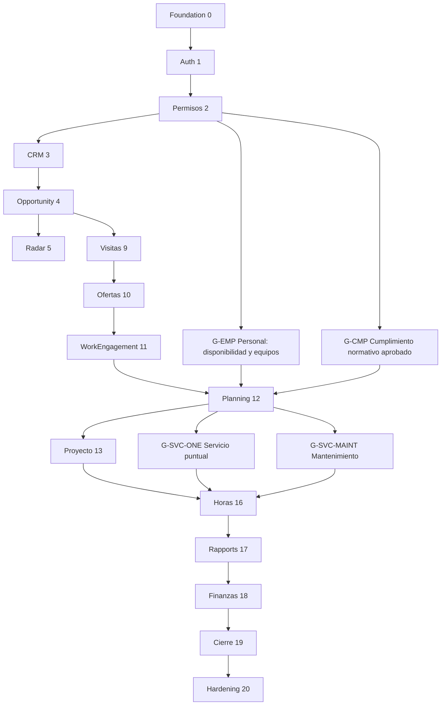

# CleanOps 360 — Dependency Graph de fases y gates

Grafo normativo de precedencia (**documental, no ejecución**). Las fases 0–20 mantienen sus identificadores, pero los gates pueden ejecutarse como vertical slices previos.

**Regla comprobable:** no publicar asignaciones sin personal elegible y conjunto de reglas laborales aplicables aprobadas; no activar servicios puntuales ni mantenimiento sin interfaz, persistencia, planificación y aceptación E2E de sus gates. Este grafo expresa dependencias mínimas críticas, no todas las dependencias auxiliares. El roadmap controla la aceptación formal de cada slice.

## Dependencias del cálculo presupuestario — ampliación 2026-10-26

Fase 9/objetos medidos + permisos fase 2 + subconjunto de reglas aplicables aprobado → fase 10 configuración/Raumbuch/cálculo → snapshot aceptado. El subconjunto normativo para cotizar se acepta antes de usar perfiles reales, sin esperar a Planning ni adelantar todo G-EMP/G-CMP. COST-GATE-01 y REQ-CALC-001…022 se detallan en ROADMAP y OFFERS_AND_NEGOTIATION_SPEC.

Snapshot/términos → fase 11 contrato/WE y adendas → fase 14 condiciones recurrentes/reajustes → fases 15–17 ejecución/horas/rapports → fase 18 rentabilidad real y efectos financieros autorizados. REQ-CALC-011/016/017/018 se cierran por capacidad real, no por simulación. Las estrategias comparten núcleo y contrato de calendario; no existe segundo Planning ni nómina/flota obligatorios. Ningún enlace de diseño autoriza iniciar fases en paralelo.
